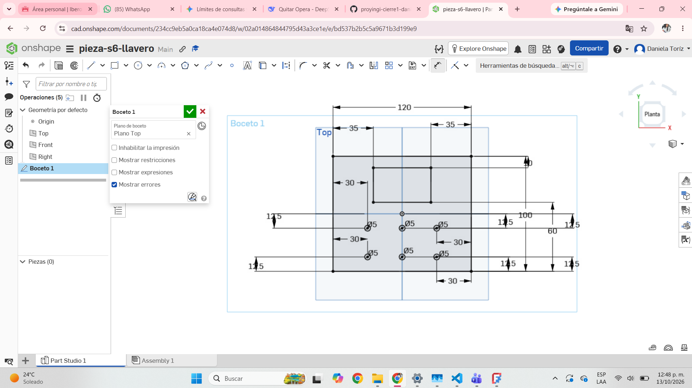

# Pieza 2D para Corte Láser — Sesión 6

**Autor:** Daniela Toríz García  
**Fecha:** 24/09/2026  
**Proyecto:** Llavero inteligente con alerta de presencia  

---

## Descripción de la pieza

- **¿Qué es la pieza?** Es la carátula y panel frontal plano para la base de pared de mi llavero inteligente[cite: 3].
- **¿Para qué sirve?** Protege el circuito interno, permite alojar los componentes electrónicos y sirve como interfaz visual del dispositivo[cite: 3].
- **Material pensado:** MDF de 3 mm para corte en máquina láser.

---

## Especificaciones de diseño

- **Medidas exteriores:** Rectángulo de 120 × 100 mm (dentro del límite permitido de 15 × 15 cm)[cite: 3].
- **Huecos internos:** 
  - Una abertura rectangular superior ubicada a 35 mm de los márgenes laterales[cite: 3].
  - Seis perforaciones circulares de 5 mm de diámetro distribuidas simétricamente en la parte inferior (separadas por 30 mm entre centros y a 12.5 mm de los bordes)[cite: 3].
- **Diseño estructural:** Placa base plana diseñada en Onshape, la cual sirvió como punto la propuesta de la pieza frontal para formar la caja, que servirá para el proyecto de mi llavero

---

## Captura con medidas

---

## Reflexión del proceso

- **¿Qué fue lo más difícil?** Calcular y acotar correctamente las coordenadas y distancias (como los espacios de 30 y 35 mm y los márgenes de 12.5 mm) en el croquis de Onshape para asegurar la posición exacta de cada perforación[cite: 3].

---

## Declaración de uso de IA

- **Herramienta utilizada:** ChatGPT / Gemini (octubre 2026).
- **Qué le pedí:** Apoyo para revisar las especificaciones de la pieza a partir del diseño en Onshape y estructurar la documentación técnica.
- **Qué modifiqué o revisé de su respuesta:** Ajusté las cotas, medidas y descripciones para que coincidieran exactamente con los parámetros mostrados en la captura del plano original.